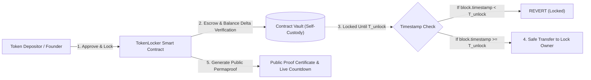
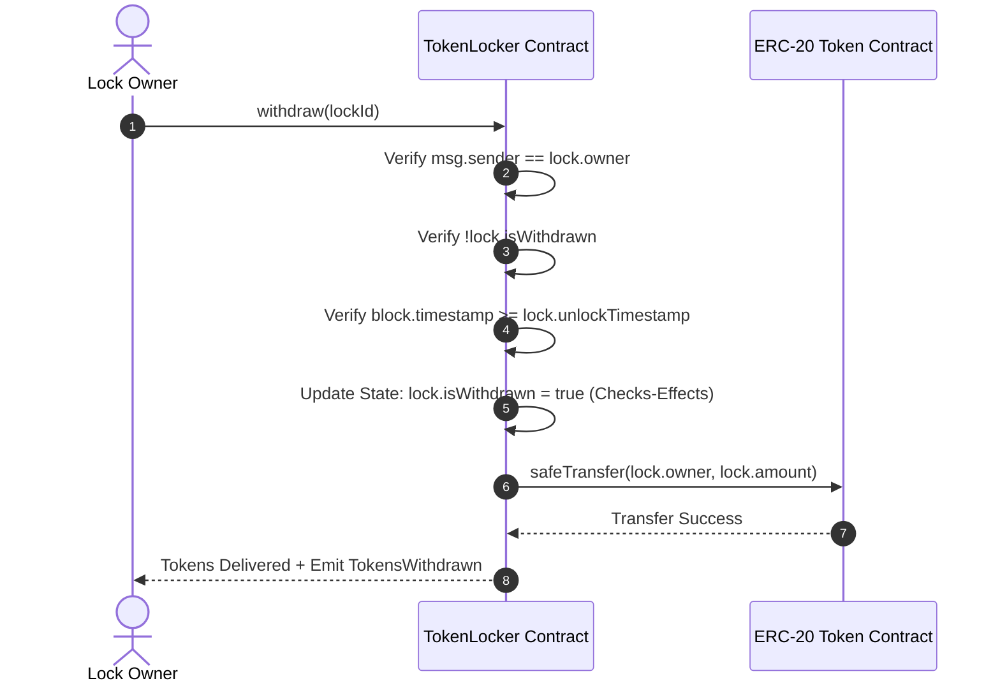
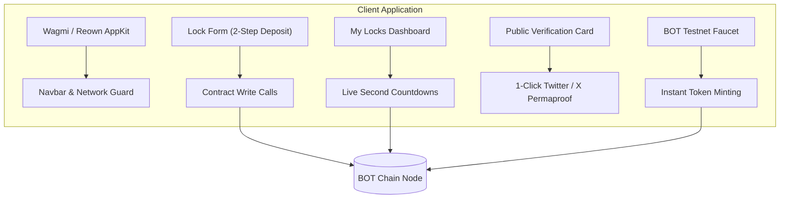
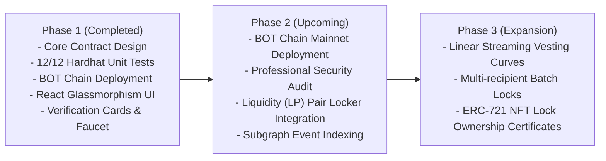

# 🔒 TokenLocker Technical Whitepaper
**A Trustless, Non-Custodial Token Locking & Vesting Protocol on BOT Chain**

*Version 1.0 — Testnet Genesis Edition*  
*Network: BOT Chain (Chain ID: 968)*  
*Core Contract: [`TokenLocker.sol`](contracts/contracts/TokenLocker.sol)*

---

## Executive Summary

The decentralized finance (DeFi) ecosystem has demonstrated remarkable innovation in capital formation and liquidity bootstrapping. However, early-stage Web3 ecosystems are frequently plagued by counterparty risk, premature developer exits ("rug pulls"), and sudden liquidity drains. 

**TokenLocker** introduces a trustless, decentralized, and non-custodial smart contract infrastructure natively deployed on **BOT Chain**. Designed from the ground up to eliminate custodial vulnerabilities and administrative intervention, TokenLocker enables project founders, core developers, decentralized autonomous organizations (DAOs), and individual investors to securely lock standard and non-standard ERC-20 tokens until verifiable on-chain timestamps have elapsed.

```
+-------------------------------------------------------------------------------+
|                             TOKENLOCKER PRINCIPLE                             |
|                                                                               |
|   "Code is Law: Zero Admin Keys, Zero Premature Withdrawals, 100% On-Chain"   |
+-------------------------------------------------------------------------------+
```

The protocol features mathematical balance differential accounting (to natively support deflationary and fee-on-transfer tokens), strictly monotonic lock extensions, transferable lock ownership, batched RPC querying, and cryptographically provable public verification certificates with social proof sharing.

---

## 1. The Trust Dilemma in Early Ecosystems

### 1.1 The Problem
In nascent blockchain networks, token communities face several persistent security challenges:
1. **Unilateral Liquidity & Reserve Dumping:** Early developers holding substantial allocations of project tokens can dump reserves on decentralized exchange liquidity pools, causing price collapse.
2. **Custodial & Pseudo-Locking Vulnerabilities:** Many traditional "locks" rely on centralized escrow services, multi-signature wallets with colluding signers, or time-delayed timelocks that retain admin override backdoors.
3. **Flawed Token Accounting in Naive Lockers:** Standard ERC-20 locker implementations assume that the requested deposit amount strictly equals the received balance. When interacting with deflationary tokens, burn-on-transfer tokens, or rebasing tokens, this disparity creates internal accounting insolvencies that freeze contract withdrawals.
4. **Opaque Verification & High Friction:** Existing proof mechanisms often require non-technical token buyers to parse block explorer byte storage, creating trust barriers that prevent legitimate founders from proving transparency.

### 1.2 The TokenLocker Solution
TokenLocker resolves these dilemmas through an immutable, zero-admin architecture:



---

## 2. Protocol Architecture & Smart Contract Design

### 2.1 Core State Model

TokenLocker operates around a clean, gas-optimized data structure:

```solidity
struct Lock {
    uint256 id;                 // Global unique identifier (monotonic counter)
    address token;              // ERC-20 token address
    address owner;              // Beneficial beneficiary of the locked funds
    uint256 amount;             // Exact tokens received by the contract
    uint256 unlockTimestamp;     // Unix timestamp after which withdrawal is unlocked
    uint256 createdAt;           // Block timestamp at lock creation
    bool isWithdrawn;           // State flag indicating settlement
    string title;               // Human-readable metadata tag
}
```

### 2.2 Mathematical Balance Difference Handling

To ensure compatibility with deflationary, burnable, and fee-on-transfer ERC-20 tokens, TokenLocker implements dynamic balance differential verification rather than blindly trusting the input `amount` parameter:

Let $B_{\text{before}}$ be the contract balance prior to the transfer:
$$B_{\text{before}} = \text{IERC20}(\tau).\text{balanceOf}(\text{address}(this))$$

The contract requests the transfer via OpenZeppelin's `SafeERC20`:
$$\text{IERC20}(\tau).\text{safeTransferFrom}(msg.sender, \text{address}(this), A_{\text{requested}})$$

The actual tokens received $A_{\text{received}}$ are computed dynamically:
$$A_{\text{received}} = \text{IERC20}(\tau).\text{balanceOf}(\text{address}(this)) - B_{\text{before}}$$

$$\text{Assert}(A_{\text{received}} > 0)$$

The recorded lock record stores $A_{\text{received}}$, ensuring that when the unlock timestamp elapses, the contract has adequate reserves to fulfill the exact withdrawal.

```solidity
// Excerpt from contracts/TokenLocker.sol
uint256 balanceBefore = IERC20(token).balanceOf(address(this));
IERC20(token).safeTransferFrom(msg.sender, address(this), amount);
uint256 receivedAmount = IERC20(token).balanceOf(address(this)) - balanceBefore;
require(receivedAmount > 0, "No tokens received");
```

---

## 3. Protocol Operations

### 3.1 Lock Creation (`lockTokens`)
Users supply the target token, desired amount, unlock timestamp, and a descriptive label.
- **Preconditions:**
  - $\tau \neq \text{address}(0)$
  - $A_{\text{requested}} > 0$
  - $T_{\text{unlock}} > \text{block.timestamp}$
- **State Modifications:**
  - Increments `lockCount` globally.
  - Instantiates `locks[lockId]`.
  - Appends `lockId` to `userLocks[msg.sender]` and `tokenLocks[token]`.
  - Emits `TokensLocked` event for indexing.

### 3.2 Withdrawal Execution (`withdraw`)
When $T_{\text{unlock}}$ has been reached or surpassed, the lock owner can claim the locked tokens.



> [!IMPORTANT]
> **Checks-Effects-Interactions (CEI) Pattern:** `lock.isWithdrawn = true` is updated strictly prior to the token dispatch call. In conjunction with `nonReentrant`, this design makes reentrancy exploits structurally impossible.

### 3.3 Monotonic Lock Extension (`extendLock`)
Project roadmaps often change, and founders may desire to lock tokens for longer durations as tokens mature. TokenLocker facilitates this via `extendLock`.
- **Inviolable Invariant:**
  $$T_{\text{new}} > T_{\text{current}}$$
- Shortening lock periods or accelerating unlock dates is strictly rejected by the EVM runtime:
  ```solidity
  require(newUnlockTimestamp > lock.unlockTimestamp, "New unlock time must be after current unlock time");
  ```

### 3.4 Beneficial Ownership Transfer (`transferLockOwnership`)
To accommodate corporate restructuring, multisig wallet migrations, or DAO governance handoffs, lock beneficiaries can assign ownership to a new counterparty without requiring token withdrawal:
- Pre-conditions: $msg.sender == \text{lock.owner}$, $\text{newOwner} \neq \text{address}(0)$, $\text{newOwner} \neq \text{lock.owner}$, $!\text{isWithdrawn}$.
- Updates internal beneficiary pointer and indexes the lock in `userLocks[newOwner]`.

### 3.5 Batched RPC Querying (`getLocksBatch`)
To circumvent RPC rate-limiting and eliminate the overhead of dozens of round-trip JSON-RPC calls on mobile or client web applications, `TokenLocker.sol` provides an on-chain batching view function:

```solidity
function getLocksBatch(uint256[] calldata lockIds) external view returns (Lock[] memory)
```

Clients query hundreds of lock records in a single RPC call, reducing frontend load times from multiple seconds to sub-200 milliseconds.

---

## 4. Threat Model & Security Analysis

```
+------------------------------------------------------------------------------------+
|                               THREAT MATRIX AUDIT                                  |
+-------------------------------+----------------------+-----------------------------+
| Attack Vector                 | Vulnerability Risk   | TokenLocker Mitigation      |
+-------------------------------+----------------------+-----------------------------+
| Reentrancy Attacks            | CRITICAL             | ReentrancyGuard + CEI       |
| Admin Privilege Abuse         | CRITICAL             | 0 Admin Roles (Immutable)   |
| Deflationary Token Traps      | HIGH                 | Pre/Post Balance Delta      |
| Front-Running Timestamps      | LOW                  | Strict block.timestamp      |
| Griefing via Transfer Denial  | MEDIUM               | SafeERC20 wrapper           |
+-------------------------------+----------------------+-----------------------------+
```

### 4.1 Zero-Admin Philosophy
Unlike many competing protocols, TokenLocker possesses **no admin keys, no owner addresses, no pause mechanisms, and no proxy upgradeability**:
- There is no `onlyOwner` modifier in the smart contract.
- No developer, validator, or founder can seize funds, halt withdrawals, or bypass timelocks.
- Once deployed, the contract acts as a permanent, immutable public utility.

### 4.2 Reentrancy and State Mutation
All four state-modifying functions (`lockTokens`, `withdraw`, `extendLock`, `transferLockOwnership`) are wrapped in OpenZeppelin’s battle-tested `nonReentrant` modifier.

### 4.3 Safe ERC-20 Non-Standard Conformance
Certain legacy tokens (e.g., USDT) do not return standard boolean values on transfer operations. By relying on OpenZeppelin `SafeERC20`, the protocol gracefully decodes low-level boolean return codes and reverts on silent failures.

---

## 5. BOT Chain Network Integration

TokenLocker is engineered to operate on **BOT Chain** (Bohr Network), capitalizing on its ultra-low gas fee schedule, high transaction throughput, and EVM compatibility.

### 5.1 Deployment Specifications

#### A. Production Mainnet
| Parameter | Specification |
| :--- | :--- |
| **Network Name** | BOT Chain Mainnet |
| **Chain ID** | `677` |
| **Native Currency** | BOT (150 Million Total Supply) |
| **RPC Endpoint** | `https://rpc.botchain.ai` |
| **Block Explorer** | [https://scan.botchain.ai](https://scan.botchain.ai) |
| **TokenLocker Core Contract** | [`0xcA7110690a29728998034f833eAFa5341D98bD5f`](https://scan.botchain.ai/address/0xcA7110690a29728998034f833eAFa5341D98bD5f) |

#### B. Public Testnet
| Parameter | Specification |
| :--- | :--- |
| **Network Name** | BOT Chain Testnet |
| **Chain ID** | `968` |
| **Native Currency** | BOT |
| **RPC Endpoint** | `https://rpc.bohr.life` |
| **Block Explorer** | [https://scan.bohr.life/](https://scan.bohr.life/) |
| **TokenLocker Core Contract** | [`0x5Ed2E76ef698cAdf1905C5FD8de89a4dA786ae52`](https://scan.bohr.life/address/0x5Ed2E76ef698cAdf1905C5FD8de89a4dA786ae52) |
| **MockERC20 Faucet Token** | [`0xBb6987f6981B31BE9e76829A6eBCa743634b8094`](https://scan.bohr.life/address/0xBb6987f6981B31BE9e76829A6eBCa743634b8094) |

### 5.2 Economic Efficiency
Because BOT Chain provides sub-cent transaction fees, creating micro-locks, vesting schedules, and periodic unlocks costs fractions of a penny. This eliminates the prohibitive \$20–\$80 transaction costs typical of Ethereum Mainnet locker platforms.

---

## 6. Frontend Ecosystem & Verification UX

The protocol's smart contracts are paired with a reactive Web3 user interface built using Vite, React 18, TypeScript, and Tailwind CSS with a dark glassmorphic cyber-aesthetic.



### 6.1 Public Cryptographic Proof Certificates
Each lock is attributed a deterministic URL identifier (`#lock-[id]`). Anyone in the community can independently inspect:
- Deposit Amount & Token Symbol
- Owner Address & Deployed Lock ID
- Exact Timestamp & Live Countdown Ticker
- BohrScan Contract Verification Link
- Direct 1-Click Sharing to Twitter/X with pre-formatted proof text.

### 6.2 Testnet Onboarding Faucet
To remove friction during testing and audits, the frontend includes a native 1-click test token minting faucet (`MockERC20.faucet()`) that deposits 1,000 `TEST` tokens directly to any connected wallet.

---

## 7. Use Cases

1. **Founding Team Vesting:** Lock developer and founding team token allocations with staggered multi-month or multi-year unlock timestamps to demonstrate long-term alignment.
2. **Liquidity Pool (LP) Locking:** Lock DEX Liquidity Provider tokens to mathematically guarantee that liquidity cannot be pulled.
3. **Strategic Investor & Advisor Escrows:** Hold advisor and seed-round tokens in non-custodial custody until vesting intervals elapse.
4. **Community Trust Signals:** Provide public verifiable proof cards in pitch decks, GitHub repositories, and social media channels.
5. **DAO Treasury Allocation Locks:** Enforce on-chain discipline for multi-year treasury disbursements.

---

## 8. Strategic Roadmap



- **Phase 1: Foundation (Delivered)**
  - Core non-custodial smart contract deployed on BOT Chain Testnet.
  - Comprehensive automated test suite (100% test passing).
  - Modern frontend with Reown AppKit, responsive lock verification cards, and testnet faucet.
- **Phase 2: Mainnet Launch & Tooling**
  - Production deployment onto BOT Chain Mainnet.
  - Native Uniswap/Pancake-style LP Token pair auto-detection.
  - Integration with BOT Chain Indexers.
- **Phase 3: Programmable Vesting & NFT Certifications**
  - Continuous block-by-block linear token vesting curves.
  - Tokenized Locks: Minting ERC-721 NFTs representing beneficial ownership of locks to enable secondary OTC trading of locked assets.

---

## 9. Conclusion

TokenLocker establishes a new standard for trustless token custody on BOT Chain. By eliminating admin privileges, providing dynamic balance-delta accounting, and delivering frictionless verification tools, TokenLocker empowers builders to foster authentic community confidence through immutable on-chain cryptography.

---

## 10. Legal & Technical Disclaimer

*This technical whitepaper is provided for informational and architectural review purposes only. TokenLocker is an open-source decentralized smart contract protocol and does not operate as a financial custodian, bank, or broker. Smart contract deployments involve inherent risks. Users and developers are advised to conduct their own due diligence before deploying or locking significant capital.*

---
*TokenLocker Protocol Team — Open Source under MIT License.*

